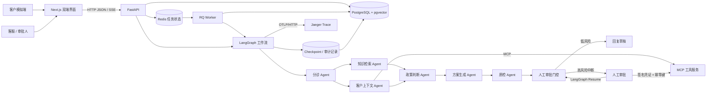

# 架构与关键决策

文档同步：2026-10-13；验证范围见[指标汇总](RESULTS.md)和[加固说明](HARDENING.md)。

## 系统边界

ResolveAI 分为八个职责边界：

1. **Next.js 产品界面**：呈现运营指标、工单、知识库、审批和 Agent 审计轨迹。
2. **FastAPI 应用服务**：提供 API、持久化业务状态并启动 LangGraph 工作流。
3. **MCP 工具服务**：提供订单、支付、客户等级和风险上下文，不直接参与 Agent 编排。
4. **PostgreSQL + pgvector**：保存工单、审批、审计、知识文档与向量，并执行数据库侧相似度检索。
5. **OpenTelemetry + Jaeger**：采集工作流、Agent、模型、RAG 与工具 Span，并提供本地可视化查询。
6. **Redis + RQ Worker**：保存长任务状态和结果，异步执行 Agent 分析、知识导入与批量评测，并通过 SSE 推送进度。
7. **性能保护层**：记录路由与工作流 P50/P95，缓存重复 RAG 检索，限制上下文与并发，并按任务重要性路由主模型和低成本模型。

8. **身份与授权层**：服务端会话、CSRF、角色、客户工单所有权和工作空间范围检查，不信任模型或前端声明的权限。

模型层支持 DeepSeek、OpenAI 和确定性 Demo 回退。业务层不依赖某一个模型供应商。

## 架构图



## 一张工单如何流转

1. **分诊 Agent** 将自然语言转成分类、优先级、情绪、意图和置信度。
2. LangGraph 并行启动：
   - **知识检索 Agent**：将工单向量化，从 21 篇政策与 SOP 中召回 Top-k 依据。
   - **客户上下文 Agent**：通过 MCP 获取订单状态、支付状态、客户等级和风险标记。
3. 两条支路完成后，**政策判断 Agent** 执行确定性业务规则。
4. **方案生成 Agent** 结合工单、订单、政策和 RAG 引用生成动作与回复草稿。
5. **质检 Agent** 检查引用、金额、执行声明、降级、时效、路径和模拟披露等规则，失败后有限重生成/转人工；自动规则不是人工语义正确性证明。
6. **审批门控 Agent** 对高风险动作暂停自动执行。
7. 高风险流程以 LangGraph `interrupt` 保存 Checkpoint 并暂停；人工审批后通过同一 `thread_id` 恢复，再由受控写工具执行具体动作。

建议不代表动作已执行，一般人工核查获批也不代表指定金额退款获批。低风险草稿不会自动执行财务动作；发送只进入待客户反馈，客户确认后才解决。七个节点中并非全部调用 LLM。

每个步骤都会产生 `audit_events`，因此前端展示的轨迹不是静态流程图，而是实际运行记录。

## 部署与健康依赖

Docker Compose 将运行依赖组织为可验证的启动链路：

```text
db(healthy) → init-db(completed) → mcp(healthy) ────────────────┐
redis(healthy) ───────────────────→ worker(healthy) → backend → frontend
tracing(Jaeger) ────────────────────────────────────────────────↗
```

- `init-db` 创建 pgvector 扩展、执行 Alembic 版本迁移，幂等补齐种子数据与私密配置中的初始员工账号；
- MCP 使用 JSON-RPC `initialize` 作为健康检查，不以“端口已打开”代替协议可用；
- FastAPI 的 `/health` 实际执行 `SELECT 1` 并返回知识文档数量；
- RQ Worker 只有在 Redis 可用并完成注册后才通过健康检查，FastAPI 的 `checks.queue` 同时报告 Worker 数量；
- Next.js 只在 FastAPI 通过健康检查后启动。
- FastAPI 通过 OTLP/HTTP 异步导出链路，Jaeger 暂时不可用不会阻断主流程。

开发者可以使用本地进程，但三进程不含 Redis/RQ/Jaeger；前端分析按钮默认走队列，完整验收须补齐服务或用 Compose。一键启动会在迁移前备份旧 Docker 数据库，手动 Compose 不自动执行此宿主机步骤。

## 身份与对象范围

- Argon2 密码；HttpOnly/SameSite 会话 Cookie；数据库存登录 Token 哈希；写请求检查 CSRF 和来源。
- 客户仅访问自己的咨询；客服分析/改写/发送，审批人审批/执行受控写工具，管理员另有账号、导入、评测及性能配置权限。
- 审批人与执行人来自服务端身份；工单、异步任务和私有导入知识按工作空间检查，检索缓存也区分空间。无访问记录的种子政策作为共享知识。
- 旧工单保留给默认项目工作人员，不按姓名猜测归属；密码/角色/状态变化使相应旧会话失效。
- 已实现基本 RBAC 和对象隔离，不等于企业 SSO、完整租户生命周期或 PII 治理；Jaeger 不复用应用登录。

## 为什么规则必须约束模型

大模型擅长理解非结构化诉求和生成自然语言，但不应该独立决定高风险资金操作。项目采用三层控制：

```text
模型提出方案 → 确定性政策校验 → 高风险动作人工批准
```

例如模型认为可以退款，只要金额超过 100 元或订单命中风险标记，政策层仍会强制进入审批。这个规则在代码中执行，不依赖提示词是否被模型正确遵守。金额阈值不代表低于阈值的写工具可以免审批；写执行器始终要求有效且范围匹配的人工审批凭证和幂等键。

## 综合置信度为什么不是模型自评分

单一模型自评分无法代表整条决策链路的可靠性。项目使用五项可观察信号：

- 意图识别置信度：25%
- RAG 最高相似度：25%
- 客户与订单上下文完整度：15%
- 质检项通过率：20%
- 方案生成置信度：15%

模型降级扣 8 分，MCP 降级扣 5 分，分项与扣分依据保存并展示。它是工程规则评分，部分输入来自模型置信度/检索相似度，并未校准成真实成功概率，也不是人工回复质量分。

## RAG、Embedding 与 pgvector 的关系

RAG 是“先检索依据，再生成方案”的产品流程；Embedding 是把文本映射成向量的方法；pgvector 负责保存向量并执行相似度检索。三者不是同一个概念。

- Embedding提供商与生成模型独立：Docker默认fastembed的512维BAAI/bge-small-zh-v1.5，亦支持显式OpenAI或local测试向量。
- 中文模型首次显式下载，后续读取带指纹的本地权重；缺失则报错，不以哈希向量冒充语义模型。
- PostgreSQL模式下向量存入pgvector，按模型指纹过滤并在数据库侧计算余弦距离；新语义表独立保留旧256维列。
- SQLite 只作为快速体验与自动化测试回退，由 Python 完成余弦计算。

中文语义检索有当前固定60条 v3 回归（Hit@K 54/55）和历史25条首轮证据；旧25条已被阅读并用于后续改进，不能继续宣称是当前版本未见过的独立数据。0.55是本项目阈值，有限模拟数据不代表生产泛化。

## MCP 在这里解决什么问题

MCP 不负责 LangGraph 的节点编排。它解决的是“Agent 应用如何用统一协议发现和调用外部工具”。当前独立 MCP Server 暴露：

- 查询订单与客户上下文；
- 计算退款试算结果；
- 执行带审批凭证与幂等键的模拟退款；
- 模拟发放带审批凭证的关怀券。

订单金额、支付/物流状态由模拟服务构造，不是商家的真实订单库；`mcp-server`说明协议调用来源，不证明业务数据真实。

如果 MCP 不可用，应用会在显式超时内有限重试，再使用本地适配器继续演示，同时在上下文、审计轨迹和置信度中记录尝试次数、失败原因与降级状态，而不是静默伪装成正常调用。

## 异常处理为什么不能只靠 try/except

ResolveAI 将故障处理建模为工作流状态，而不是只写日志：

- 模型和 MCP 分别设置超时、最大重试次数及退避时间；
- RAG 结果低于可靠性阈值时跳过方案模型，明确拒绝无依据回答；
- 分析质检失败携带失败项重生成，耗尽后转人工；改写失败保留原稿，发送再次校验，不可靠回复不能写入客户对话；
- 多个节点连续失败达到阈值时，审批门控会强制暂停；
- `assessment.resilience`、Agent 审计事件和工具执行记录共同保存失败原因及重试次数。

## 运营指标如何计算

总览与效果分析不使用写死数字：

- 工单总量、解决率、待审批量和问题分布来自业务表。
- Agent 平均耗时来自审计记录。
- 七日趋势按上海时区聚合审计事件，并按工单 ID 去重。
- 当天出现人工审批或客服发送的工单计入人工处理，其余计入 Agent 自动处理。
- 项目创建前没有记录的日期保持为 0。

性能页另读持久化用量与工作流台账，不只累加最终 assessment。每次模型尝试包括重试、改写与付费解析失败；机器耗时包含排队，客户创建至主动确认的周期另计，包含人工和客户等待。

## 关键数据表

- `tickets`：工单原文、分类、方案、回复、置信度和 assessment。
- `knowledge_documents`：政策全文、分类、来源和向量。
- `audit_events`：Agent、人工与模拟执行动作的审计日志。
- `approvals`：高风险动作、金额、审批状态、审批人和意见。
- `tool_executions`：写工具参数、审批关联、幂等状态与执行结果。
- `langgraph_checkpoints` / `langgraph_checkpoint_writes`：LangGraph 原生状态快照和节点中间写入。
- `workflow_checkpoints`：当前节点、下一节点、工具结果及当前会话的可读快照。

- `knowledge_embeddings`：按模型/内容指纹保存512维语义向量，保留旧256维数据。
- `accounts` / `login_sessions` / `login_attempts`：账号、Token哈希、会话过期与尝试限流。
- `ticket_access` / `task_access` / `knowledge_access`：对象访问范围。
- `model_usage` / `workflow_runs`：每次模型尝试及排队、处理、结束和失败台账。

## 数据初始化

业务启动执行 Alembic：0001接管原业务表，0002增加身份与台账等表及Checkpoint字段；缺必要列时拒绝盲目接管，重复升级不重复建表。之后按source补齐21篇种子知识、示例工单和不存在的初始员工账号。隔离测试/评测可直接建测试元数据，但业务库不再以create_all代替版本迁移。

`python -m scripts.init_database`是独立初始化入口。已有库先备份，默认拒绝破坏性降级；恢复验证创建UUID副本，不覆盖原库。SQLite到PostgreSQL脚本是另一项一次性数据迁移，不替代Alembic。

## 测试金字塔

- 单元测试：工具 Schema、权限、风险策略、脱敏、状态计算和置信度；
- 集成测试：SQLite/PostgreSQL 抽象、RAG、MCP 工具边界、LangGraph 七节点与持久化；
- 端到端测试：客户提交、Agent 分析、人工审批、退款工具、幂等重放、发送回复与客户确认；
- Agent 评测：60 条业务及对抗用例，生成 JSON/Markdown 基线报告；
- 前端检查：ESLint 与 Next.js production build。

## 生产化的下一步

- Alembic、基本登录/RBAC、对象隔离和备份恢复已实现；进一步分离迁移/业务数据库权限，完善长期/异地备份与保留策略。
- 为 MCP Server 增加 OAuth 和用户级 RBAC；当前已具备工具白名单、工具级权限、审批凭证、幂等键和调用审计。
- 扩充真正未参与调试的数据、独立人工语义复核，跟踪本轮3条分类失误；不把自动通过率当作人工分。
- 将当前 Jaeger 内存存储替换为持久化 Trace 后端，并增加链路指标告警。
- 将基本身份/工作空间检查、限流和字段脱敏扩展为企业身份与PII生命周期治理，不宣称成熟多租户平台。
- 将模拟退款、发券和发送动作替换为带沙箱与审批权限的真实业务接口。
- HTTPS模板与生产预检已准备；实际域名/DNS、部署授权、账单核对与真实业务接入仍需负责人确认。
